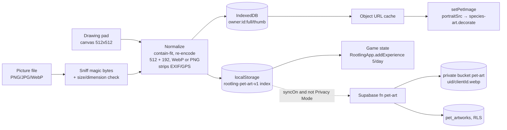

# Pet artwork integration walkthrough (Rootling v16)

This doc explains how user-made pet artwork plugs into Rootling's pet game. Muse leads user experience and Computer leads abilities and skills (see `TEAM.md`). It covers the asset ingestion pipeline, format rules, the backup endpoint, rendering for the ADHD- and COPD-friendly loops, and the code that connects artwork to game state.

Files in this change:

| File | What it does |
|---|---|
| `pet-art.js` | New module `RootlingPetArt`. Handles ingestion, format checks, normalizing, storage, engagement loops, the drawing pad, the shelf, and optional backup. |
| `species-art.js` | `decorate(img, species, stage, mood, custom)` takes a 5th arg so stage size and mood overlays also apply to the user's drawing. |
| `app.js` | `setPetImage`, the quiet view and the celebration all use the painted art again (this was lost in f9389cd). `setPetImage` also uses the user's drawing when they choose it. Adds `RootlingApp.refreshPet()` and `RootlingApp.connected`. Registers the store key. Restores the CORS fix from 0f0255e. |
| `index.html` | Loads `species-art.js` and `pet-art.js` before `companions.js`. Adds the `#pet-art-card` on the Activities tab. |
| `accounts.js` | Adds `rootling-pet-art-v1` to `APP_KEYS`, so each account keeps its own drawings. |
| `sw.js` | `rootling-v16`. Adds both art scripts to `APP_SHELL`. |
| `styles.css` | Styles for the pad, breathing ring, sprint bar and shelf, with calm-mode and reduced-motion overrides. |
| `supabase/migrations/20261016000000_pet_art.sql` | `pet_artworks` table, RLS, a 48-item cap, and the private `pet-art` bucket with per-user folder policies. |
| `supabase/functions/pet-art/index.ts` | Backup endpoint: `save`, `list` and `delete`. |
| `tools/pet-art.test.js`, `tools/check.js` | 25 unit checks. `check.js` now protects the card, the script order, the store key, the hooks and the CORS fix. |

## 1. Architecture at a glance



Everything to the left of the dotted line runs on the device with no network. That follows Daniel's standing rule that data stays on the device unless the user turns on a connected helper.

## 2. Asset ingestion pipeline

1. **Input.** Either the drawing pad (an `HTMLCanvasElement`) or a file from "Add a picture I made".
2. **Check.** `sniffType()` reads the first 12 bytes, so the file's real type matters, not its name. `checkInput()` then applies the format rules below. Error messages use plain words with no exclamation points.
3. **Decode.** `createImageBitmap(blob, { imageOrientation: 'from-image' })` decodes the image, so phone photos come out the right way up. If that isn't available, it falls back to ``.
4. **Normalize.** `fitRect()` contain-fits the image into a transparent 512 square and a 192 square. These match the painted set (`<slug>.webp` and `<slug>-sm.webp`). The image is then re-encoded with `toBlob('image/webp', 0.86)`. If the browser hands back PNG instead, the PNG is kept. Re-encoding drops every metadata block, including GPS.
5. **Store.** The blobs go into IndexedDB `rootling-pet-art/blobs` under the key `<accountId>:<itemId>:full|thumb`. The small index goes into localStorage `rootling-pet-art-v1`. `accounts.js` already scopes that key to each account.
6. **Game state.** The first real drawing of the day calls `RootlingApp.addExperience(5, 'drew your pet')`. That function enforces the shared 30-a-day bonus cap.
7. **Render.** The module warms an object URL so that `portraitSrc()` can answer synchronously inside `setPetImage`.
8. **Clean up.** "Delete my pet drawings" (in `AREA_KEYS`) clears the index. On the next boot, `sweepOrphans()` removes that account's leftover blobs.

## 3. Format requirements

| Rule | Value | Why |
|---|---|---|
| Accepted input | PNG, JPEG, WebP (checked by magic bytes) | SVG can carry scripts, and GIF/APNG motion breaks calm mode |
| Input size | at most 8 MB | phone photos fit; huge files don't block the main thread |
| Input sides | shortest at least 64 px, longest at most 4096 px | too small looks blurry; too big risks running out of memory on phones |
| Stored portrait | 512 x 512, transparent, WebP q0.86 (PNG fallback), at most 600 KB | same frame as `assets/pets/*.webp`, so `--art-scale` works unchanged |
| Stored thumbnail | 192 x 192, at most 120 KB | same as `*-sm.webp`, used on the shelf |
| Items per account | 48 | matches the server cap trigger |
| Server re-check | magic bytes, 512 x 512 parsed from the PNG IHDR or WebP VP8/VP8L/VP8X header, size limits, 20 saves per hour | the device's checks are never trusted alone |

## 4. Backup endpoint

This works like the existing `scan` and `oauth-start` functions: one POST endpoint, called with the user's Supabase JWT through `RootlingApp.connected.call('pet-art', body)`. The function runs as the user, not with the service role, so RLS and the storage folder policies decide what each person can touch. CORS allows only `authorization, content-type`, which is why `callFunction` must not send `apikey`.

| Action | Request body | Response |
|---|---|---|
| save | `{ action:'save', clientId, species, label, source:'drawn'\|'upload', mime, image:<base64>, thumb:<base64> }` | `200 { id, path }`. Errors: `401` sign in, `413` too big, `415` wrong type, `422` not 512 x 512, `429` slow down, `409` shelf full |
| list | `{ action:'list' }` | `200 { items:[{ id, clientId, species, label, source, createdAt, url, thumbUrl }] }`. URLs are signed for 1 hour |
| delete | `{ action:'delete', clientId }` | `200 { ok:true }` |

A save is retried with the same `clientId` and `upsert: true`, so retrying never creates a duplicate. Upload only happens when all three of these are true: the user turned on "Back up my drawings" (`index.syncOn`, off by default), they are signed in to Connected accounts, and Privacy Mode is off.

Deploy:

```bash
supabase db push                       # runs 20261016000000_pet_art.sql
supabase functions deploy pet-art
```

## 5. Rendering and engagement loops

`loopFor(state)` reads the user's own choices: support styles (`state.profiles`) and "Things you live with" (`state.topics`). It never guesses or labels the user. `loopConfig(loop)` holds every timing, so the UI never hard-codes one.

| | Focus loop (ADHD-friendly) | Breath loop (COPD-friendly) | Mixed (both) |
|---|---|---|---|
| Trigger | `focus` style or `adhd`/`attention` topic | `copd`, `asthma` or `heart` topic | both |
| Timer | optional 90 s "Quick sketch". The user starts it and can stop it. There's no fail state | none | none (breath pacing wins) |
| Feedback | "Nice line" cheers every 30 s, instant pet reaction, +points on the first save | one rest nudge after 3 min | breath ring + rest nudge |
| Choices | 4 colors (start faster) | 6 colors | 4 colors |
| Pacing | none | ring grows for 2 s on the breath in and shrinks for 4 s on the breath out ("draw on the breath out"), the same pursed-lip rhythm as `fitness.js` | same |
| Targets | 48 px | 56 px, thicker brushes (less fine arm work) | 56 px |
| Voice | not needed | not needed (talking costs breath) | not needed |
| Stopping | autosave every stroke | autosave every stroke | autosave |

Rules for every loop:

- Rewards are small and capped: 5 points once a day, inside the shared 30-a-day cap. Nothing is random, no streaks are lost, and there's no shaming. This keeps points from turning into a compulsion loop for ADHD users.
- `body.calm`, `html.calm-motion` and `prefers-reduced-motion` stop the ring, the sprint bar and the mood overlays. Calm mode shows the breathing words without motion.
- On Home, the drawing keeps the game's language. The stage still shows through `--art-scale` (cub 0.87, grown 1 with a gold glow). Mood still shows through overlays (z's, cloud, sparkles, heart). The alt text reads "Your drawing of your Kraken companion, cub stage, ...".
- A drawing shows on Home only when the user taps "Show on Home", and only for the species it was drawn for. Otherwise the painted portrait shows, and the SVGs stay as the last fallback.

## 6. Code patterns for connecting artwork to game state

Render hook (`app.js` `setPetImage`):

```js
var SA = window.RootlingSpeciesArt, sp = SA ? SA.speciesOf(state) : '';
var art = SA ? SA.src(sp, stage.id, mood) : '';
var PA = window.RootlingPetArt, mine = PA ? PA.portraitSrc(sp, stage.id) : '';
if (mine) art = mine;
if (art) primary = art;
if (SA) SA.decorate(img, art ? sp : '', stage.id, mood, !!mine);
```

Growth from art (`pet-art.js` `save`):

```js
var pts = awardFor(index, item);              // 5 once a day, real drawings only
var out = RootlingApp.addExperience(pts, 'drew your pet');  // shared 30/day cap
if (out && out.added) index.lastAwardDay = todayKey();
```

Redraw after a change, without reaching into app.js internals:

```js
RootlingApp.refreshPet();                     // setPetImage(lastArtMood)
window.addEventListener('rootling:pet-art', function (e) { /* e.detail.activeId, asPortrait */ });
```

Starting the pad from any feature (Adventures, Ask your pet, onboarding):

```js
RootlingPetArt.mountPad(el, { loop: 'breath', onSaved: function (r) { /* r.item, r.added, r.stageUp */ } });
```

A pet command, if Computer adds one to `assistant.js` later:

```js
if (/\b(draw|paint|sketch)\b.*\b(pet|companion)\b/i.test(text)) { RootlingNav.reveal('pet-art-card'); document.getElementById('pet-art-open').click(); }
```

## 7. Tests and checks

- `node tools/pet-art.test.js` runs 25 checks: magic bytes (SVG disguised as PNG is refused), size and side limits, fit math, loop selection, the mixed loop, calm motion, points once a day, and the portrait species rule.
- `node tools/check.js` now also fails when any of these goes missing: `pet-art.js`, the load order `species-art.js → pet-art.js → app.js`, `#pet-art-card`/`#pet-art-pad`/`#pet-art-list`, the store key in all four lists, `RootlingApp.refreshPet`/`connected`, or `RootlingPetArt` in `app.js`. It also fails if `callFunction` sends `apikey` again.
- Browser test (Chromium, 390 px wide): created an account and adopted a Kraken, which showed the painted portrait. Drew and saved on the Activities tab (+5 growth points). "Show on Home" swapped the portrait to the drawing with cub size and sparkles. The drawing stayed after a reload, and there were no page errors. The server's dimension parser read the browser's WebP output as 512 x 512.
